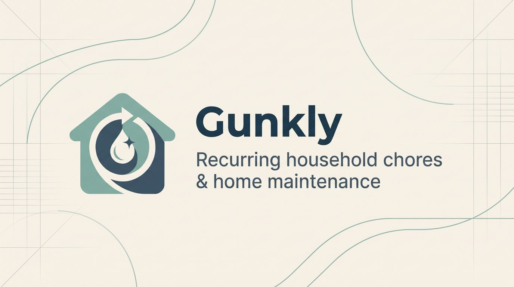

<picture>
  <source media="(prefers-color-scheme: dark)" srcset="docs/assets/banner-dark.jpg">
  
</picture>

A self-hostable chore tracker for recurring household chores and home maintenance (gutters, washing-machine filter, descaling the kettle). Flexible schedules, optional reminders on your own messaging services, and a calm interface on phone and desktop. One Go binary, one container, SQLite or Postgres. No telemetry.

**Status: pre-alpha, under construction.** Nothing here is ready for use yet.

## Quick start

Needs Docker with Compose. The compose files pull `ghcr.io/nexusbetweenvoids/gunkly` (published from the first release; until then `docker compose ... up -d --build` builds it from this checkout).

```sh
cp .env.example .env
# Generate an encryption key and put it in .env as GUNKLY_SECRET_KEYS=1:<key>
echo "GUNKLY_SECRET_KEYS=1:$(openssl rand -base64 32)"
# Set GUNKLY_BASE_URL to the address you will open Gunkly at (scheme://host[:port], no path).

# SQLite (one container)
docker compose -f compose.sqlite.yml up -d

# or Postgres (Gunkly plus Postgres): also set POSTGRES_PASSWORD in .env
docker compose -f compose.postgres.yml up -d
```

Keep `GUNKLY_SECRET_KEYS` safe and backed up: it protects stored two-factor secrets and notification URLs, and Gunkly refuses to start without it. Every setting is documented in `.env.example`.

On first start Gunkly logs a one-time setup code (the `setup_code` field of a `FIRST-RUN SETUP` line). Find it, then open the app (port 8080) and enter it to create the admin account:

```sh
docker compose -f compose.sqlite.yml logs gunkly | grep setup_code
```

The code only works until the first account exists; if you miss it, restart the container for a new one.

## Upgrading

```sh
docker compose -f compose.sqlite.yml pull
docker compose -f compose.sqlite.yml up -d
```

Pending database migrations are applied on start (`GUNKLY_AUTO_MIGRATE=true`, the default); with SQLite a snapshot is written to `/data/backups/pre-migrate-<timestamp>.db` first. Set it to `false` to apply them yourself with `docker compose -f compose.sqlite.yml run --rm gunkly migrate`. Back up before upgrading.

## SQLite or Postgres

| Choose | When |
|-|-|
| **SQLite** (default) | One household, family and friends, or a small community instance; one container and simple one-command backups |
| **Postgres** | A larger or public instance; you already run and back up Postgres; you want the database on its own server, or more than one app container later |

Switching later (`gunkly migrate-db`) is planned for a later release.

## Backups

Never copy the data volume while Gunkly is running; SQLite's write-ahead log can make the copy corrupt. Use:

```sh
docker compose -f compose.sqlite.yml exec gunkly /gunkly backup - > backup.db
```

The snapshot is consistent while Gunkly runs. Without the `-` argument it is written inside the data volume (`/data/backups`) instead. For Postgres use `pg_dump`. Restore by stopping Gunkly and placing the file as `gunkly.db` in the data volume.

## Releases and verification

Pushing a `vX.Y.Z` tag builds a multi-arch (linux/amd64, linux/arm64) image at `ghcr.io/nexusbetweenvoids/gunkly` (tags `X.Y.Z`, `X.Y`, `latest`), signs it with keyless cosign and attests an SPDX SBOM. The GitHub release carries the SBOM (`sbom.spdx.json`), plain static binaries and `SHA256SUMS`.

Verify the image signature and the SBOM attestation:

```sh
cosign verify ghcr.io/nexusbetweenvoids/gunkly:<tag> \
  --certificate-identity-regexp 'https://github.com/NexusBetweenVoids/gunkly/.github/workflows/release.yml@refs/tags/v.*' \
  --certificate-oidc-issuer https://token.actions.githubusercontent.com

cosign verify-attestation ghcr.io/nexusbetweenvoids/gunkly:<tag> --type spdxjson \
  --certificate-identity-regexp 'https://github.com/NexusBetweenVoids/gunkly/.github/workflows/release.yml@refs/tags/v.*' \
  --certificate-oidc-issuer https://token.actions.githubusercontent.com
```

Verify a binary: `sha256sum -c --ignore-missing SHA256SUMS`.

## Documentation

`docs/PRD.md` (scope and requirements), `docs/adr/` (decisions), `docs/THREAT_MODEL.md`, `SECURITY.md`, `CONTRIBUTING.md`, `AGENTS.md`.

## License

AGPL-3.0. See `LICENSE`.
