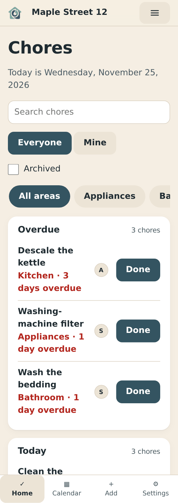
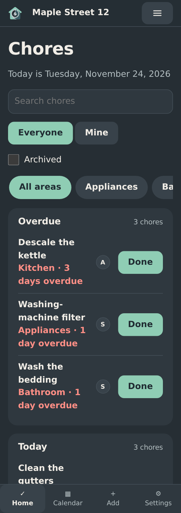
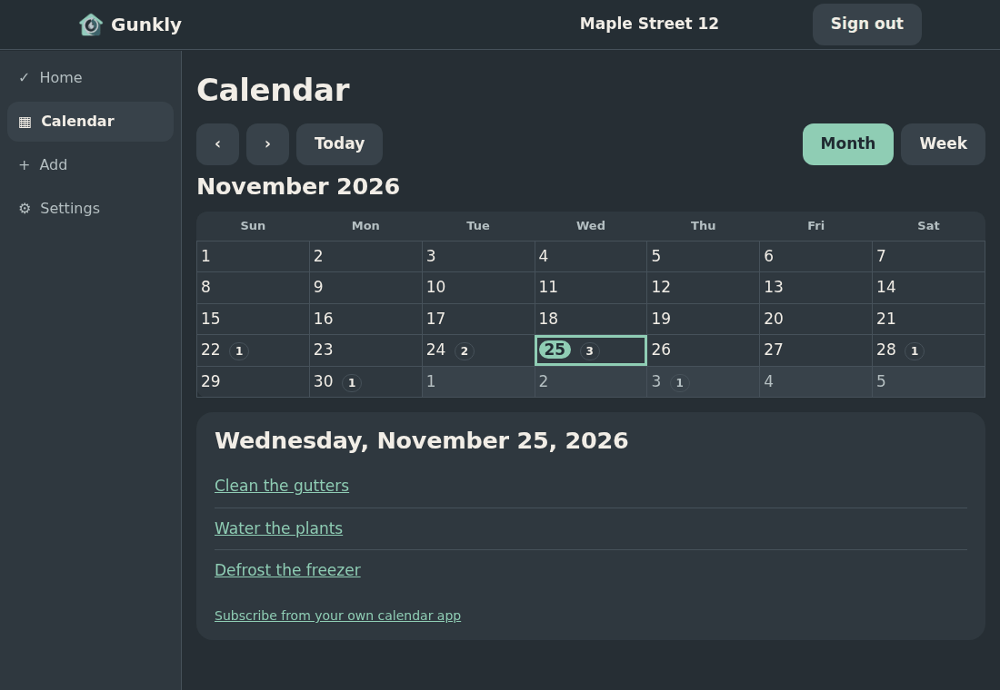
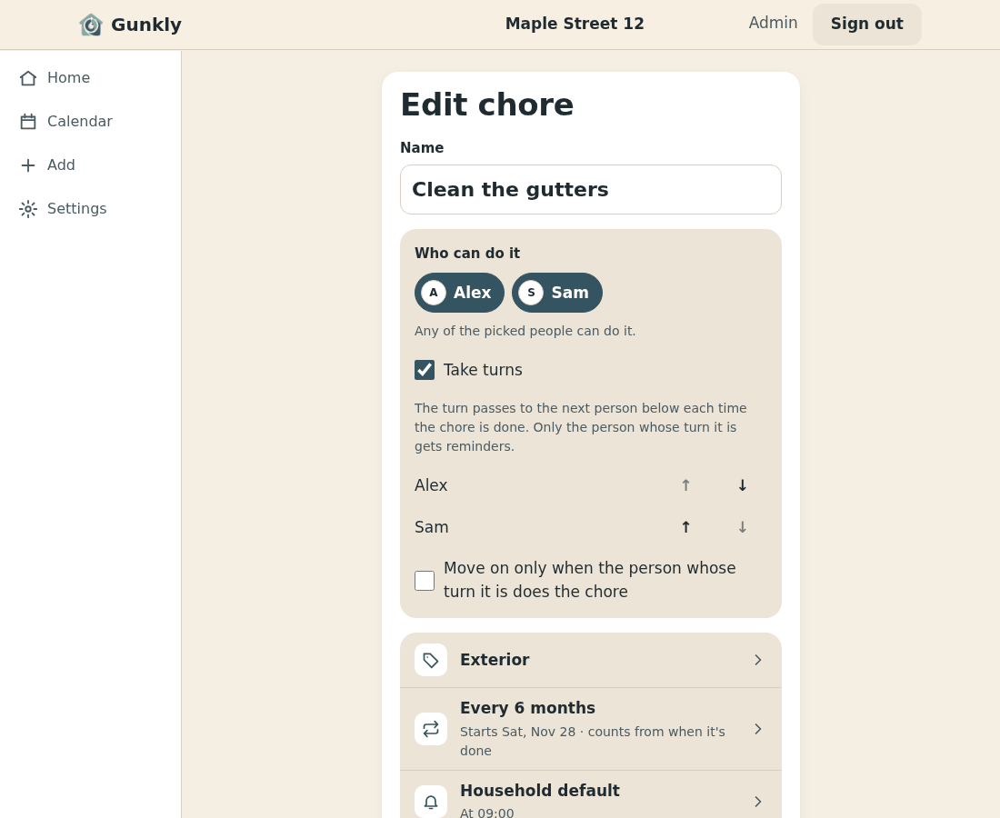
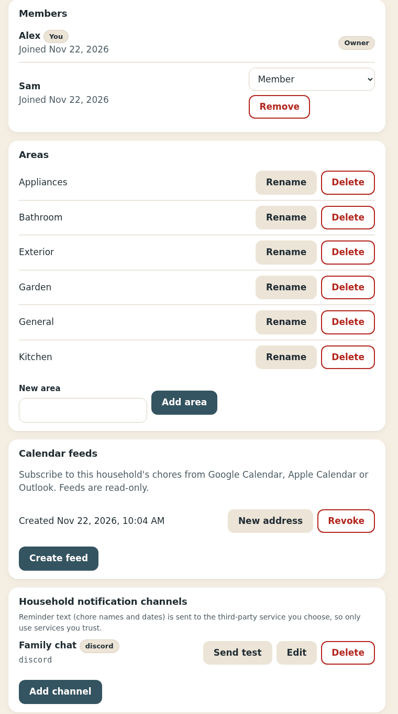

<picture>
  <source media="(prefers-color-scheme: dark)" srcset="docs/assets/banner-dark.jpg">
  
</picture>

<p align="center">
  <a href="https://github.com/NexusBetweenVoids/gunkly/actions/workflows/ci.yml"></a>
  <a href="https://github.com/NexusBetweenVoids/gunkly/actions/workflows/codeql.yml"></a>
  <a href="LICENSE"></a>
  <a href="go.mod"></a>
  <a href="web/package.json"></a>
  
  <a href="Dockerfile"></a>
  <a href="https://github.com/NexusBetweenVoids/gunkly/releases/latest"></a>
  <a href="https://hub.docker.com/r/gunkly/gunkly"></a>
  <a href="docs/ai-assistants.md"></a>
  <a href="https://github.com/NexusBetweenVoids/gunkly-homeassistant"></a>
  
  
  
</p>

A self-hostable, **AI-friendly** chore tracker for recurring household chores and home maintenance (gutters, washing-machine filter, descaling the kettle). Flexible schedules, optional reminders on your own messaging services, and a calm interface on phone and desktop. One Go binary, one container, SQLite or Postgres. No telemetry.

- **Works with AI assistants:** a built-in [MCP server](docs/ai-assistants.md) lets AI assistants that support MCP — such as Claude, Gemini CLI, Cursor and VS Code — list, complete, snooze and plan your chores — limited to the households and actions you allow, revocable at any time.
- **Works with your smart home:** a [Home Assistant integration](https://github.com/NexusBetweenVoids/gunkly-homeassistant) adds to-do lists, sensors and a calendar; a scoped REST API covers the rest.
- **Built and maintained with AI, openly:** most of the code, tests and docs are written by AI coding agents working from a public plan and strict rules ([AGENTS.md](AGENTS.md)), with a human maintainer deciding scope and reviewing. Every change has to pass the same automated gates — tests on SQLite and Postgres, linting, security scanning (CodeQL, govulncheck, ZAP), accessibility checks and independent AI security reviews. If you find something an AI or a human missed, please [report it](SECURITY.md).

**Status: early release.** Expect rough edges; please [report issues](https://github.com/NexusBetweenVoids/gunkly/issues). Pin a version tag in production and back up before upgrading.

## Screenshots

| Home, phone (light) | Home, phone (dark) |
|-|-|
|  |  |

| Calendar, desktop (dark) | Chore editor, desktop (light) |
|-|-|
|  |  |

<p align="center"><br><sub>Household settings (light): grouped into General, People, Notifications, Connections and Data.</sub></p>

All screenshots show synthetic demo data.

## Features

**Chores and schedules**
- Recurring (every N days, weeks or months, or a calendar rule such as "every Saturday" or "every April and October") and one-off chores.
- Next due date from completion or from the scheduled date; monthly rules on the 29th to 31st fall on the month's last day; time zone and DST aware.
- Assignees (none, one or many); one completion by anyone completes it for everyone. Optionally take turns: the turn, and its reminders, rotate through the assignees.
- Snooze, skip once, pause, archive; undo right after completing, revert later from history; optional areas (off by default), notes, link, starter templates.
- Home screen grouped Overdue / Today / This week / Later, with "Mine / Everyone" (and area filters if you turn areas on).

**Reminders and notification channels**
- Per chore: before due, on the due date, repeating while overdue (at most once per 24 h); household presets and quiet hours, plus personal quiet hours (deferred, not dropped); per-user mutes.
- Channels per user and per household through [Shoutrrr](https://containrrr.dev/shoutrrr/) service URLs: Discord, Slack, Telegram, Pushover, Pushbullet, Google Chat and ntfy.sh on by default; self-hosted ntfy, generic webhook, SMTP, MQTT, Matrix, Gotify and more can be enabled by the admin.
- Built-in Web Push to browsers and installed PWAs; no third-party account needed.
- Scoped API tokens for Home Assistant, scripts and AI assistants (see Integrations / API tokens).
- Optional signed outgoing webhooks for chore events (off by default, admin switch; see [Outgoing webhooks](#outgoing-webhooks)).
- Reminders carry a mark-done link (confirmation page, single use, 5-minute undo); delivery log with retries and backoff.

**Calendar and iCal feeds**
- Month and week views by due date.
- Read-only iCal feeds per user and household (Google Calendar, Apple Calendar, Outlook); revocable and regenerable; names, areas and dates only.

**Households, roles and invites**
- Several households per user, each fully isolated. Roles: owner, member, guest (view only, no reminders).
- Expiring, revocable invite links (1 to 100 uses). Optional open sign-up with proof of work (off by default when self-hosted).

**Security and privacy**
- Argon2id passwords, optional TOTP with recovery codes, optional email codes; step-up checks for sensitive actions; sessions you can list and revoke.
- Notification URLs, TOTP secrets and push keys are encrypted at rest with your own key (`GUNKLY_SECRET_KEYS`, rotatable); other secrets are stored only as hashes.
- Outbound requests go through an SSRF guard with a service allowlist; strict CSP, CSRF protection, rate limits and usage limits.
- No telemetry. The optional update check can be switched off. Account deletion and optional inactive-account clean-up.

**Export and import**
- Per-user data export and household export as JSON; import as a new household or merge into an existing one. See [Export and import](#export-and-import).

**Admin and operations**
- First-run setup code, users and instance settings (limits, sessions, retention, allowed services, sign-up), update notice, CLI recovery (`admin reset-password`, `admin reset-2fa`).
- `/healthz`, `/readyz`, optional Prometheus `/metrics`, consistent backups, `migrate-db` to Postgres, graceful shutdown.
- English only for now; translations and right-to-left layout are wired in. Installable PWA (no offline mode). WCAG 2.2 AA tested.

## Quick start

Needs Docker with Compose. No checkout needed: make an empty folder, save this as `compose.yml`, and replace the two placeholder values.

```yaml
services:
  gunkly:
    image: gunkly/gunkly:0.4   # pin a version; also on ghcr.io/nexusbetweenvoids/gunkly
    restart: unless-stopped
    ports:
      - "4865:4865"
    environment:
      # Generate with: openssl rand -base64 32   (keep it safe and backed up)
      GUNKLY_SECRET_KEYS: "1:REPLACE_WITH_GENERATED_KEY"
      # The exact address you open Gunkly at (scheme://host[:port], no path),
      # e.g. http://192.168.1.10:4865 — requests from any other address are refused
      GUNKLY_BASE_URL: "http://localhost:4865"
    volumes:
      - gunkly-data:/data
    read_only: true
    cap_drop: [ALL]
    security_opt: ["no-new-privileges:true"]
    stop_grace_period: 40s   # Gunkly drains for up to 30 s on shutdown

volumes:
  gunkly-data:
```

```sh
docker compose up -d
docker compose logs gunkly | grep setup_code   # one-time code to create the admin account
```

Open http://localhost:4865, enter the setup code and create your admin account. That's it — no email server needed; see [docs/getting-started.md](docs/getting-started.md) for the next steps. Every other setting is optional and listed in [`.env.example`](.env.example); add them under `environment:`.

Prefer working from a checkout? `compose.sqlite.yml` and `compose.postgres.yml` in this repo do the same with an `.env` file (`cp .env.example .env`).

Keep `GUNKLY_SECRET_KEYS` safe and backed up: it protects stored two-factor secrets and notification URLs, and Gunkly refuses to start without it.

The setup code only works until the first account exists; if you miss it, restart the container for a new one. Put a TLS-terminating reverse proxy in front for anything beyond localhost (Web Push and installing the PWA need HTTPS) and list its address in `GUNKLY_TRUSTED_PROXIES` (see [Behind a reverse proxy](#behind-a-reverse-proxy)).

### Postgres

```sh
# also set POSTGRES_PASSWORD in .env
docker compose -f compose.postgres.yml up -d
```

| Choose | When |
|-|-|
| **SQLite** (default) | One household, family and friends, or a small community instance; one container and simple one-command backups |
| **Postgres** | A larger or public instance; you already run and back up Postgres; you want the database on its own server |

## Behind a reverse proxy

A reverse proxy (Caddy, nginx, Traefik, Nginx Proxy Manager, ...) gives Gunkly HTTPS. Gunkly only believes the client address the proxy forwards (`X-Forwarded-For` or the standard `Forwarded` header) when the proxy is listed in `GUNKLY_TRUSTED_PROXIES`. Without it, every request seems to come from the proxy: the activity log and session list show the proxy's address, and the per-address rate limits (sign-in, sign-up, invites) treat all visitors as one, so everyone shares one login limit. Gunkly never trusts a proxy by itself; the Administration page shows a warning with the exact setting to copy when it sees forwarded requests from an address that is not trusted.

**Find the proxy's address as Gunkly sees it:**

- Proxy on the host (or another machine): its LAN address, for example `192.168.1.1`.
- Proxy in a container on the same Docker network: that network's subnet. Run `docker network inspect <network> | grep Subnet`, for example `172.18.0.0/16`. `172.16.0.0/12` covers all default Docker networks.

```sh
GUNKLY_TRUSTED_PROXIES=192.168.1.1/32                  # one address
GUNKLY_TRUSTED_PROXIES=172.18.0.0/16                   # a Docker network
GUNKLY_TRUSTED_PROXIES=192.168.1.1/32,172.16.0.0/12    # several, comma-separated
```

Only list proxies you control, and make sure Gunkly's port is not reachable except through them. Also set `GUNKLY_BASE_URL` to the public https address (for example `https://chores.example.com`).

**Caddy** sets `X-Forwarded-For` by default:

```
chores.example.com {
	reverse_proxy gunkly:4865
}
```

**nginx:**

```nginx
location / {
	proxy_pass http://gunkly:4865;
	proxy_set_header Host $host;
	proxy_set_header X-Forwarded-For $proxy_add_x_forwarded_for;
	proxy_set_header X-Forwarded-Proto $scheme;
}
```

**Traefik** sets `X-Forwarded-For` by default; point a router at the service on port 4865 (for example with the labels `` traefik.http.routers.gunkly.rule=Host(`chores.example.com`) `` and `traefik.http.services.gunkly.loadbalancer.server.port=4865`).

**Nginx Proxy Manager:** the defaults work; add a proxy host for `gunkly` port `4865` with an SSL certificate.

## Configuration

Everything is set through environment variables, all documented with their defaults in [`.env.example`](.env.example). The ones you will touch first:

| Variable | Purpose |
|-|-|
| `GUNKLY_SECRET_KEYS` | Required. Encryption keys, `<version>:<base64 32-byte key>` |
| `GUNKLY_BASE_URL` | Public origin used in links (no path) |
| `GUNKLY_DATABASE_URL` | `sqlite:///data/gunkly.db` or `postgres://...` (the compose files set it) |
| `GUNKLY_TRUSTED_PROXIES` | Reverse-proxy CIDRs/IPs whose `X-Forwarded-For` / `Forwarded` is trusted; see [Behind a reverse proxy](#behind-a-reverse-proxy) |
| `GUNKLY_EMAIL_ENABLED` and `GUNKLY_SMTP_*` | Email verification, password reset, email codes (optional) |
| `GUNKLY_METRICS_TOKEN` | Enables `/metrics` |
| `GUNKLY_AUTO_MIGRATE` | Apply migrations on start (default `true`) |

Limits, sign-up, sessions, retention, allowed notification services and the egress guard are admin settings in the app (Administration: Sign-up & sign-in, Connections, Data & retention, Limits).

## Backups

Never copy the data volume while Gunkly is running; SQLite's write-ahead log can make the copy corrupt. Use:

```sh
docker compose -f compose.sqlite.yml exec gunkly /gunkly backup - > backup.db
```

The snapshot is consistent while Gunkly runs. Without the `-` argument it is written inside the data volume (`/data/backups`) instead. For Postgres use `pg_dump`. Also keep `GUNKLY_SECRET_KEYS` with the backup: without it encrypted values cannot be read.

**Restore:** stop Gunkly, place the snapshot as `gunkly.db` in the data volume, delete any `gunkly.db-wal` and `gunkly.db-shm` next to it, and start Gunkly. For Postgres use `pg_restore`.

## Upgrading

```sh
docker compose -f compose.sqlite.yml pull
docker compose -f compose.sqlite.yml up -d
```

Pending database migrations are applied on start (`GUNKLY_AUTO_MIGRATE=true`, the default); with SQLite a snapshot is written to `/data/backups/pre-migrate-<timestamp>.db` first. Set it to `false` to apply them yourself with `docker compose -f compose.sqlite.yml run --rm gunkly migrate`. Back up before upgrading. Administration, Updates shows the running version and the latest release (see [Updates](#updates)).

## Switching from SQLite to Postgres

`gunkly migrate-db` copies a SQLite instance into an empty Postgres database and verifies the copy. It needs no secret key (sealed values are copied as stored) and never writes to the SQLite file.

1. Take a backup (`gunkly backup`) and stop Gunkly so nothing changes during the copy.
2. Create an empty Postgres database and role. The target must hold no tables (an empty `schema_migrations` table is fine); the command refuses anything else.
3. If you have just upgraded, start Gunkly once or run `gunkly migrate` so the SQLite database has no pending migrations; the command refuses a source with pending migrations.
4. Run the copy with the Gunkly binary or image, for example `docker compose -f compose.sqlite.yml run --rm --no-deps gunkly /gunkly migrate-db ...` (the Postgres host must be reachable from there, and the SQLite file readable at the path you give):

   ```sh
   gunkly migrate-db --from sqlite:///data/gunkly.db --to 'postgres://gunkly:PASSWORD@db:5432/gunkly?sslmode=disable'
   ```

   It creates the schema at the same version, copies every table in foreign-key order from one consistent read snapshot, then compares per-table row counts and a SHA-256 over the rows (ordered by primary key, values normalised across both databases) inside the same target transaction. It commits only if everything matches; on any mismatch or error nothing is left in the target (rerun after fixing the cause) and the exit status is non-zero.
5. Set `GUNKLY_DATABASE_URL` to the Postgres URL (compose: use `compose.postgres.yml`), keep the same `GUNKLY_SECRET_KEYS`, and start Gunkly. Keep the SQLite file until you are satisfied; it is untouched.

## Monitoring

Set `GUNKLY_METRICS_TOKEN` (16 or more characters, for example `openssl rand -hex 24`) to serve Prometheus metrics at `/metrics`. Without it the route does not exist. Scrape with the token as a bearer token:

```yaml
scrape_configs:
  - job_name: gunkly
    authorization: {type: Bearer, credentials: <your token>}
    static_configs: [{targets: ['gunkly:4865']}]
```

The series are build info, HTTP requests by route and status class, a request duration histogram, deliveries by channel kind, scheduler tick age, delivery queue depth and open database connections. Nothing is labelled by user or household. Keep `/metrics` off the public internet if you can: block it at your reverse proxy.

## Updates

Administration, Updates shows the running version and the latest release with its changelog. Once every 12 hours at most, Gunkly asks the public GitHub release API for the latest release (user agent `gunkly-update-check`, no information about your server) and caches the answer. Switch it off on the same page and Gunkly makes no request at all. Gunkly never updates itself: pull the new image and restart; migrations run on start.

## Browser notifications

Under Account, Notifications, "Turn on reminders on this device" subscribes the browser to Web Push (HTTPS or localhost, and a browser with push support). Messages are encrypted to the browser and delivered through the browser vendor's push service, which sees that a message was sent and when. Push follows the same recipients, mutes and quiet hours as your other channels.

## Integrations / API tokens

Under Account, "Integrations", create an access token for Home Assistant, a script or an AI assistant (via an MCP server). A token is bound to the households you choose and to the permissions you give it: see and read chores (`chores:read`), mark them done, snooze, skip and pause them, and change whose turn it is on a chore that takes turns (`chores:complete`), and add, change or delete them (`chores:write`). It never exceeds your own role in a household (a guest's token can only read), can expire, is shown once and can be revoked at any time. It can never change members, settings, notification channels or your account.

```sh
curl -H "Authorization: Bearer gk_..." https://gunkly.example.com/api/v1/token
curl -X POST -H "Authorization: Bearer gk_..." https://gunkly.example.com/api/v1/households/<id>/chores/<id>/complete
```

Requests with a token need no cookies or CSRF header. See [api/openapi.yaml](api/openapi.yaml) (`bearerAuth`) and [ADR 0014](docs/adr/0014-api-tokens.md). Treat a token like a password.

## Outgoing webhooks

Gunkly can POST a signed JSON message to a web address when a chore is completed, becomes overdue, is created, changed, deleted, snoozed or skipped, so home automation and scripts can react without polling. Optional and **off by default**: an admin turns it on under Administration, "Connections"; while off nothing is sent and the routes answer 404. Household owners then add webhooks under the household settings, Connections, "Webhooks (advanced)" (https addresses only, unless the admin switched the egress guard off for self-hosting). Every request is signed (`Gunkly-Signature: t=<unix>,v1=<HMAC-SHA256 of "<t>.<body>">`, with a per-webhook secret shown once), goes through the egress guard, never follows redirects, retries with backoff and is logged (last 50 per webhook); 20 failures in a row switch the webhook off. Payloads, signature checks in shell, Python and Node, and the retry rules are in [docs/webhooks.md](docs/webhooks.md); design in [ADR 0017](docs/adr/0017-outgoing-webhooks.md).

## Home Assistant

The [Gunkly integration for Home Assistant](https://github.com/NexusBetweenVoids/gunkly-homeassistant) (installable through HACS as a custom repository) adds a to-do list per household — ticking an item completes the chore — plus overdue and due-today sensors, a calendar, actions to complete, snooze or skip chores, and an event when a chore becomes overdue. Create an API token with the `chores:read` and `chores:complete` scopes (add `chores:write` to create chores from Home Assistant).

## Use with AI assistants (MCP)

Gunkly has a built-in [MCP](https://modelcontextprotocol.io) server, so an AI assistant can list, complete, snooze, skip and add chores for you. It is the Streamable HTTP endpoint `https://<host>/mcp` and uses an [access token](#integrations--api-tokens) from Account, "Integrations": give the token only the households and permissions the assistant needs.

Claude Code:

```sh
claude mcp add --transport http gunkly https://<host>/mcp --header "Authorization: Bearer gk_..."
```

Any client that takes a JSON configuration (Claude Desktop through a remote-server connector, Cursor, and others):

```json
{
  "mcpServers": {
    "gunkly": {
      "type": "http",
      "url": "https://<host>/mcp",
      "headers": { "Authorization": "Bearer gk_..." }
    }
  }
}
```

Tools, by the permission they need (the assistant only sees the ones its token allows): `list_households`, `list_chores`, `get_chore` and `upcoming` (`chores:read`); `complete_chore`, `undo_completion`, `snooze_chore` and `skip_chore` (`chores:complete`); `create_chore` (`chores:write`). Everything goes through the same household and role checks as the app, completions are recorded as made by the token and appear in the audit log, and the usual per-token rate limits apply. Chore names and notes are text your household typed: a client should treat them as data, never as instructions. An instance admin can switch the endpoint off under Administration, "Connections". See [ADR 0015](docs/adr/0015-mcp-server.md).

Assistants that cannot take an access key (ChatGPT custom connectors, Claude's "Add custom connector") sign in with OAuth 2.1 instead: optional and **off by default**, an admin turns it on under Administration, "Connections" (it needs `GUNKLY_BASE_URL` to be a public `https://` address). Users then approve the app on a Gunkly consent page, pick the households and actions it may use, and can disconnect it under Account, "Integrations". Its tokens work for `/mcp` only. See [ADR 0016](docs/adr/0016-oauth-for-mcp.md) and [Connect an AI assistant](docs/ai-assistants.md#chatgpt-and-claude-connectors).

## Export and import

Every user can download their own data (Account, Your data, "Export my data"; asks for the password again) and members and owners can export a household (household settings, Data, "Export household") as JSON. The files never contain notification URLs, tokens, calendar feed links or member email addresses. A household file can be imported as a new household or merged into one you are a member of (areas with the same name are combined, chores are added as new ones, assignees are matched to members by username). Uploads are limited to 5 MiB and an import is all-or-nothing.

## Releases and verification

Pushing a `vX.Y.Z` tag builds a multi-arch (linux/amd64, linux/arm64) image, published at `ghcr.io/nexusbetweenvoids/gunkly` and on Docker Hub as `gunkly/gunkly` (tags `X.Y.Z`, `X.Y`, `latest`), signs it with keyless cosign and attests an SPDX SBOM. The GitHub release carries the SBOM (`sbom.spdx.json`), plain static binaries and `SHA256SUMS`.

Verify the image signature and the SBOM attestation:

```sh
cosign verify ghcr.io/nexusbetweenvoids/gunkly:<tag> \
  --certificate-identity-regexp 'https://github.com/NexusBetweenVoids/gunkly/.github/workflows/release.yml@refs/tags/v.*' \
  --certificate-oidc-issuer https://token.actions.githubusercontent.com

cosign verify-attestation ghcr.io/nexusbetweenvoids/gunkly:<tag> --type spdxjson \
  --certificate-identity-regexp 'https://github.com/NexusBetweenVoids/gunkly/.github/workflows/release.yml@refs/tags/v.*' \
  --certificate-oidc-issuer https://token.actions.githubusercontent.com
```

The same commands work for `gunkly/gunkly:<tag>`. Version 0.1.0 was copied to Docker Hub after release, so its Docker Hub signature comes from `.github/workflows/dockerhub.yml` instead of `release.yml` (use that path in the identity regexp, with `@refs/heads/main`).

Verify a binary: `sha256sum -c --ignore-missing SHA256SUMS`.

## Hosted service

The maintainer runs a free, non-commercial hosted instance; its operations and legal texts live outside this repository. Self-hosters run their own instance and are responsible for their own data.

Every instance can delete accounts (Account, Your data, "Delete account") and can optionally remove accounts that stay inactive: an admin switches it on under Administration, "Data & retention" (default off; warning after 365 days, deletion after 548 days without activity, a final warning 30 days before; instance admins are never deleted).

## Documentation

| | |
|-|-|
| [docs/getting-started.md](docs/getting-started.md) | First-run walkthrough |
| [docs/webhooks.md](docs/webhooks.md) | Outgoing webhooks: payloads, signatures, retries |
| [docs/PRD.md](docs/PRD.md) | Scope and requirements |
| [docs/adr/](docs/adr/) | Architecture decisions |
| [docs/THREAT_MODEL.md](docs/THREAT_MODEL.md) | Threat model |
| [api/openapi.yaml](api/openapi.yaml) | The `/api/v1` HTTP API |

## Contributing, security, license

- Contributing: [CONTRIBUTING.md](CONTRIBUTING.md) (rules for agents and humans: [AGENTS.md](AGENTS.md)).
- Security: report vulnerabilities as described in [SECURITY.md](SECURITY.md).
- License: AGPL-3.0, see [LICENSE](LICENSE).
