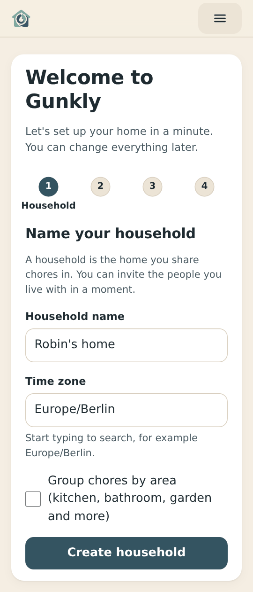
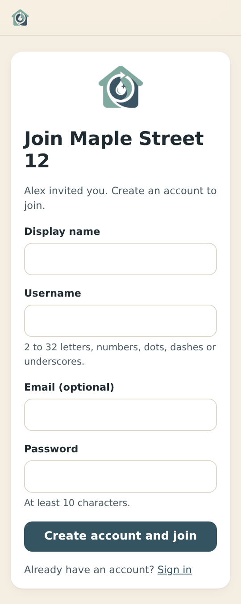
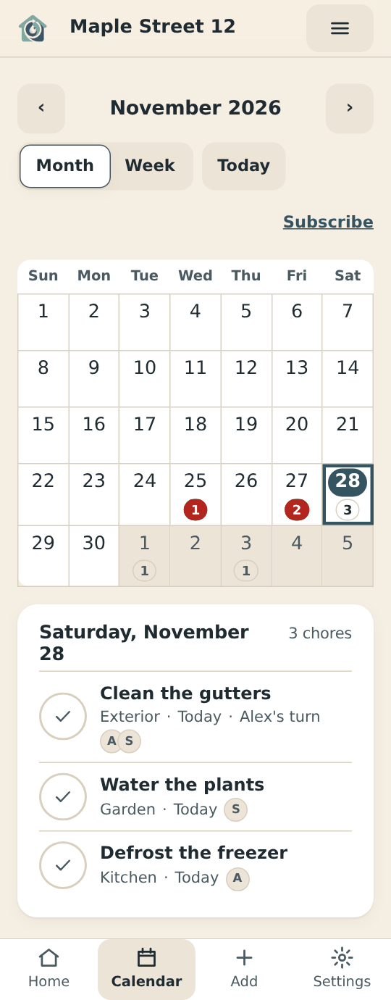
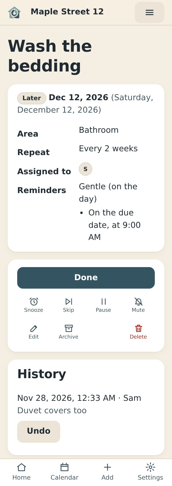
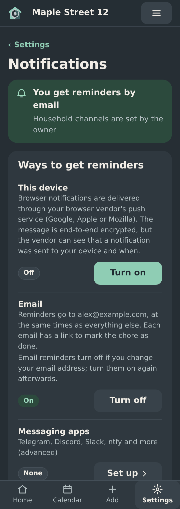

# Getting started

A first-run walkthrough for a self-hoster. Reference material is in the [README](../README.md) and [`.env.example`](../.env.example).

## 1. Start the container

You need Docker with Compose and a copy of this repository (or just the compose file and `.env.example`).

```sh
cp .env.example .env
echo "GUNKLY_SECRET_KEYS=1:$(openssl rand -base64 32)"   # put this line in .env
```

Edit `.env`: set `GUNKLY_SECRET_KEYS` and `GUNKLY_BASE_URL` (the address you will open, `scheme://host[:port]`, plus a path such as `/gunkly` only when you serve it under a prefix: see [Under a path prefix](../README.md#under-a-path-prefix)). Back up the secret key; Gunkly will not start without it.

```sh
docker compose -f compose.sqlite.yml up -d      # or compose.postgres.yml (also set POSTGRES_PASSWORD)
```

Gunkly listens on port 4865. For anything beyond localhost, put a TLS reverse proxy in front and set `GUNKLY_TRUSTED_PROXIES` to its address (the admin page warns if you forget; see [Behind a reverse proxy](../README.md#behind-a-reverse-proxy)); Web Push and installing the app need HTTPS (or `localhost`).

## 2. Create the admin

On first start Gunkly prints a one-time setup code. Find it:

```sh
docker compose -f compose.sqlite.yml logs gunkly | grep setup_code
```

Open `GUNKLY_BASE_URL`. You land on the setup screen: enter the code, choose a username and password and create the instance admin. The code stops working once the account exists (restart the container for a new one if you missed it).

A short setup guide follows, one optional step at a time: it checks the server address, then lets you set up email, single sign-on, AI chore suggestions and updates right there, without touching Docker again. Skip anything you don't need; everything stays changeable under Administration (which also links back to the guide). Settings you put in the environment win and show as locked.

Optional: add a passkey or an authenticator app under Settings, Sign-in & security. The page starts with one line that says how well the account is protected ("Only a password protects this account", "Protected by a password and a passkey"), then lists every way to sign in with its state and one action.

## 3. Create a household

On Home, choose "Set up your home". A short welcome flow follows: name the household (a name is suggested and the time zone comes from your browser; tick "Group chores by area" for areas such as Kitchen and Bathroom), pick a few starter chores (common ones are ticked, their first dates spread over the coming week) and create an invite link to copy or share. Every step after the household can be skipped. (The setup guide's "Create your household" link opens a plain form with just the name and time zone instead.) Reminder times use the household time zone. Areas and everything else stay changeable in the household's Settings, General, which also has "Create another household".

To share it later, open the household's part of Settings, People and create an invite link (choose a role: member, or guest for view-only). Send the link: the other person sees which household it joins and who invited them ("Join Maple Street 12 · Alex invited you"), then signs up or signs in and accepts it. A revoked, expired or used link says so straight away. Open sign-up is off by default on a self-hosted instance, so create their account under Administration, Users first, or turn sign-up on under Administration, Sign-up & sign-in.

<p align="center"> </p>

## 4. Add chores

Use "Add": type a name or tap a template (or "More…" for all of them), and tap the people who can do it (nobody picked means anyone). Below that, one row each opens a sheet: the area (if your household uses areas), Repeat (first due date, how often, "Custom rule…" for calendar rules such as "every April and October", and whether the next date counts from when it's done or from the due date) and Reminders (a preset, or Custom, and the time of day). "Notes and link" unfolds in place. Pick two or more people and a "Take turns" option appears: the people take turns in the order shown (use the arrows to change it), only the person whose turn it is gets reminders and sees the chore under "Mine", and after someone completes it the turn passes to the next person. The chore page shows whose turn it is and lets you change it, with Done, Snooze, Skip and Pause and the chore's history. Completing a chore from Home or the Calendar schedules the next due date; Undo is shown right after. The Calendar shows a month or a week; tap a day to see its chores, and a red count marks past days with chores still open.

<p align="center"> </p>

## 5. Get reminders

New households remind on the due date at 09:00 ("Gentle"); change it per chore, or for the whole household in its Settings. Reminders are optional and each person chooses how to get theirs. Settings, Notifications starts with a line that answers "will I get reminders?" (a warning when nothing is on), then lists this device, email and messaging apps, each with its state and one action. Everyone, including non-technical family members, can do this in under a minute:

1. **On this phone or computer:** open Gunkly, and on Home tap "Turn on" in "Get reminders on this device?" (or Settings, Notifications, "This device", "Turn on"), then allow notifications. It needs HTTPS. On an iPhone or iPad, first open Gunkly in Safari, tap Share, choose "Add to Home Screen", then open Gunkly from the Home Screen and turn reminders on there.
2. **By email** (when the server sends email): add and confirm your email address under Settings, Profile & email, then choose "Turn on" next to Email in Settings, Notifications. Each email has a link to mark the chore as done.
3. **For the whole household:** an owner or member can add a household channel in the household's part of Settings, Notifications, for example your family Telegram or Discord group; reminders then reach everyone without anyone setting anything up.

<p align="center"></p>

Advanced: Settings, Notifications, "Messaging apps" holds personal channels. Choose "Set up", then "Add channel", pick a service and follow the short steps shown. For Discord, Slack, Telegram, Pushover, Pushbullet, Google Chat and ntfy you only enter what that app gives you (a webhook link, a bot token and chat, a topic, ...) and Gunkly builds the address itself; each service also links to its full setup guide. Services the admin enables beyond those take a [Shoutrrr](https://shoutrrr.nickfedor.com/) service URL. Use "Send test" to check it. The URL is stored encrypted and never shown again.

Set quiet hours (only the switch shows until you turn them on), the household default preset and per-chore presets as needed. Reminder messages contain chore names and dates, so only use services you trust.

Optional: email (verification, password reset, email codes). Set `GUNKLY_EMAIL_ENABLED=true` with the `GUNKLY_SMTP_*` settings and restart.

## 6. Install the app (PWA)

Open Gunkly over HTTPS in a supported browser and use its "Install" or "Add to Home Screen" option. The installed app has no offline mode.

## 7. Subscribe to the calendar feed

Open the household's part of Settings, Connections, "Calendar feeds", "Create feed" and copy the address (also reachable from "Subscribe from your own calendar app" on the Calendar screen). Add it as a subscription calendar in Google Calendar, Apple Calendar or Outlook. The feed is read-only and lists chore names, dates and, if areas are on, areas only. "New address" replaces the link and "Revoke" turns it off.

## Next steps

- Connect an AI assistant such as Claude: [AI assistants](ai-assistants.md).
- Back up: `docker compose -f compose.sqlite.yml exec gunkly /gunkly backup - > backup.db` (see [Backups](../README.md#backups)).
- Monitoring and upgrades: [README](../README.md).
