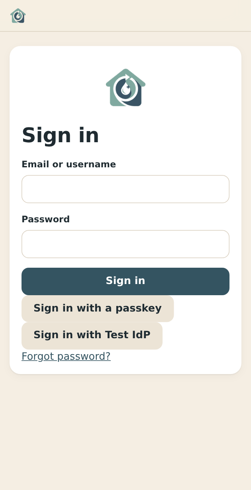
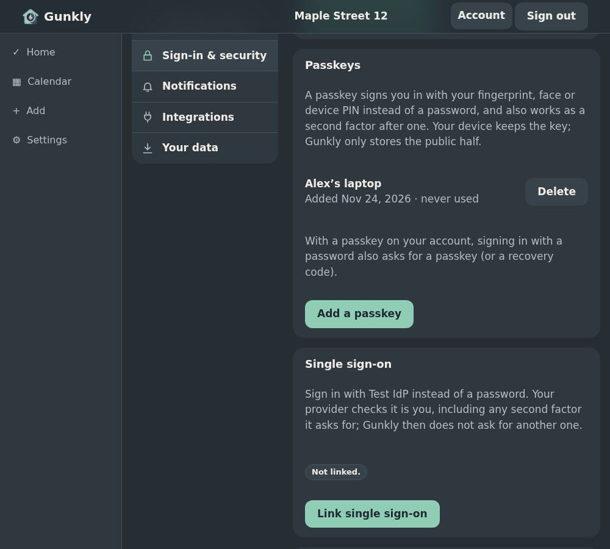

# Signing in: passwords, second factors and passkeys

Gunkly signs people in with a **username (or email) and password**. On top of that an account can have a **second factor**:

| Second factor | Where | Notes |
|-|-|-|
| Authenticator app (TOTP) | Account, Sign-in & security | Single-use recovery codes come with it. |
| Emailed codes | Account, Sign-in & security | Needs email on the instance and a verified address. Replaces the authenticator app. |
| Passkey | Account, Sign-in & security | Can be added next to either of the above. |

Hosted mode requires a second factor for every account. Self-hosted, all of them are optional. Self-hosted instances can also sign in through [single sign-on](sso.md).

## Passkeys

A passkey is a key pair kept by your phone, laptop, password manager or security key. Gunkly stores only the public half. You approve it with the device's PIN, fingerprint or face.

**Add one:** Account, Sign-in & security, **Passkeys**, **Add a passkey**. You are asked to confirm your password (and second factor) first, then your browser asks you to create the passkey. Give it a name so you can tell devices apart. Each passkey shows when it was added and last used; you can delete it at any time (this also needs the confirmation, and signs your other devices out). You can have up to 20.

**What it does:**

- **Sign in without a password.** On the sign-in page choose **Sign in with a passkey**. Your device must verify you (PIN, fingerprint or face), which is why this counts as password plus second factor in one.
- **Second factor.** After you enter your password, Gunkly asks for a passkey (or a code) as the second step. An account with a passkey is asked for it at every password sign-in; a recovery code works instead. When you add your first second factor, Gunkly shows recovery codes once: keep them.
- **Confirming sensitive actions.** Changing your password, adding an access token, approving an AI assistant on its consent page and similar actions ask you to confirm it is you. A passkey can do that alone (on the consent page, press **Confirm with a passkey**).

**Requirements.** Passkeys are bound to the address you open Gunkly at, so the administrator must set `GUNKLY_BASE_URL` to an **https** address (or `http://localhost` for trying it out); an IP address does not work. Without that the account screen says so and the buttons are disabled. If the address ever changes, existing passkeys stop working (the other factors and recovery codes still do), so register new ones.

**Lost your device?** Sign in with the password and a recovery code, then remove the passkey. Self-hosted administrators can also run `gunkly admin reset-2fa <user>`, which removes the authenticator app, emailed codes, **passkeys** and recovery codes of that account.

**What is stored.** The credential ID, the public key, a signature counter, the transports and the authenticator model (AAGUID). No attestation is requested, so Gunkly never learns which device made a key. If a passkey's counter ever goes backwards (a sign of a cloned key) the sign-in is refused and the event shows up in the account's recent activity. The data export lists names and dates, never key material.

## Single sign-on

Self-hosted instances can also offer sign-in through an OpenID Connect identity provider. It is set up by the administrator ([docs/sso.md](sso.md)); users link it under Account, Sign-in & security. A single sign-on counts as fully authenticated, so the provider's own multi-factor is the second factor and Gunkly does not ask for another.

Design details: [ADR 0018](adr/0018-passkeys-and-sso.md).
