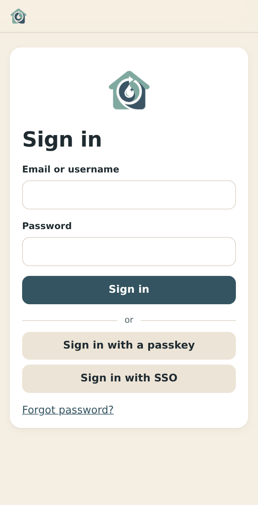

# Single sign-on (OpenID Connect)

Gunkly can sign people in through an identity provider you already run: Authelia, Authentik, Keycloak, Kanidm, Zitadel, Pocket ID, Google and anything else that speaks OpenID Connect. It is **for self-hosted instances only**: in hosted mode the feature does not exist (its routes answer 404 and the settings are refused at start-up).

Password sign-in stays available next to it. There is deliberately no "SSO only" switch.

<p align="center"></p>

## What it does

- **Sign in** with a button on the sign-in page ("Sign in with Authelia"). The name is set under Administration, Sign-up & sign-in, "Name on the single sign-on button"; if that is empty, `GUNKLY_OIDC_NAME`; if both are empty the button says "Sign in with SSO". The button appears only when SSO is configured.
- **Link and unlink** under Account, Sign-in & security, **Single sign-on**. Linking and unlinking ask you to confirm it is you first. You can unlink only while you still have a password or a passkey to sign in with.
- **Who is who:** a user is identified by the pair **(issuer, `sub`)**, never by email or username. Gunkly never links an account because an email address matches, so nobody can take over an account by registering its address at the provider.
- **First sign-in by someone with no linked account:** by default they see "No Gunkly account is linked..." and can sign in with their password and link it. An administrator can switch on **Create accounts for new single sign-on users** (Administration, Sign-up & sign-in; off by default). Then the first sign-in creates an account: the username comes from `preferred_username` (cleaned up to letters, digits, dot, dash and underscore, and made unique with `-2`, `-3`, ...), the display name from `name`, and the email address is kept **only** when the provider says `email_verified` is true and email is enabled on this instance. Such an account has no password; it can set one under Account (it confirms its identity through the provider first). It does not need one to approve an app on the OAuth consent page of the assistant integration: the page offers **Confirm with {provider}**, which asks the provider to authenticate you again and brings you back to the same request (with a passkey registered, **Confirm with a passkey** works too).
- **Two-factor:** a sign-in through SSO counts as fully authenticated. Whatever multi-factor the provider asks for is the second factor; Gunkly does not ask for another one (an authenticator app or passkey on the Gunkly account is not asked for after SSO). Choose your provider's policy accordingly (for example Authelia's `two_factor` policy). Sensitive actions in Gunkly (changing the password, creating an access token, deleting the account, ...) still ask the user to confirm: with the password and second factor, a passkey, or, for linked users, the provider again (it is asked to authenticate the user anew with `prompt=login` and `max_age=0`; a provider that ignores both is only as strong as its own session).

## Configuration

Set these in the environment of the Gunkly container:

| Variable | Meaning |
|-|-|
| `GUNKLY_OIDC_ISSUER` | The provider's issuer URL, **exactly** as in its discovery document (`<issuer>/.well-known/openid-configuration`), trailing slash included if it has one. `https` (plain `http` only for `localhost`). |
| `GUNKLY_OIDC_CLIENT_ID` | The client ID of the application you registered for Gunkly. |
| `GUNKLY_OIDC_CLIENT_SECRET` | Its secret. Leave empty only for a public client (PKCE is always used). |
| `GUNKLY_OIDC_NAME` | Default name for the button, for example `Authelia` (at most 50 characters). Optional; the admin setting overrides it, and without either the button says "Sign in with SSO". |
| `GUNKLY_OIDC_SCOPES` | Default `openid profile email`. `openid` is always included. |

`GUNKLY_BASE_URL` is required and must be an **https** address (or localhost): the provider sends the browser back to it. Register this redirect URI at the provider:

```
{GUNKLY_BASE_URL}/api/v1/auth/oidc/callback
```

For example `https://gunkly.example.com/api/v1/auth/oidc/callback`. Gunkly uses the authorization code flow with PKCE (`S256`), `state` and `nonce`, and verifies the ID token's signature (RS, PS, ES and EdDSA algorithms the provider advertises, so Kanidm's ES256 works), issuer, audience, expiry and nonce. The provider is contacted when someone first uses SSO, not at start-up, so it may start after Gunkly; if it is unreachable the sign-in page says so and password sign-in is unaffected.

### Providers on your LAN

Self-hosted providers usually live on the local network. Gunkly's outbound guard normally refuses connections to private addresses, but the provider's address comes from the environment you control, not from a user, so **requests to the issuer's own host and port are allowed to reach private addresses**. This client follows no redirects, has timeouts and caps response sizes. Any *other* host named in the provider's discovery document (a token or key endpoint elsewhere, as Google's are) is still subject to the guard, unless you turned it off in the admin settings. Keep the issuer, token and key endpoints on one host if you run the provider on your LAN.

### Tested in CI

A GitHub Actions workflow (`.github/workflows/sso-idp.yml`, config in `test/idp/`) signs in to Gunkly through real **Keycloak 26.8.2** and **authentik 2026.8.6** with a browser: first sign-in creating an account, signing in again, linking from a password account, and re-confirming through the provider. It runs on SSO-related changes, nightly and before every release. The other providers below are configured from their documentation and not tested automatically.

### Authelia

In Authelia's `configuration.yml`:

```yaml
identity_providers:
  oidc:
    clients:
      - client_id: gunkly
        client_name: Gunkly
        client_secret: '$pbkdf2-sha512$...'   # the digest of the secret (authelia crypto hash generate)
        public: false
        authorization_policy: two_factor
        require_pkce: true
        pkce_challenge_method: S256
        redirect_uris:
          - https://gunkly.example.com/api/v1/auth/oidc/callback
        scopes: [openid, profile, email]
        token_endpoint_auth_method: client_secret_basic
```

Gunkly:

```
GUNKLY_OIDC_ISSUER=https://auth.example.com
GUNKLY_OIDC_CLIENT_ID=gunkly
GUNKLY_OIDC_CLIENT_SECRET=<the plain secret>
GUNKLY_OIDC_NAME=Authelia
```

Newer Authelia versions keep profile claims out of the ID token unless a `claims_policy` asks for them. Gunkly reads `preferred_username`, `name`, `email` and `email_verified` from the ID token; if accounts it creates have generated names, add those claims to the policy.

### Authentik

Create a provider (Applications, Providers, **OAuth2/OpenID Provider**) and an application using it:

- Client type **Confidential**; note the client ID and secret.
- **Grant types:** make sure *Authorization Code* is enabled (and *Refresh Token*). Current authentik releases refuse the authorization request with `invalid_request` (the provider's log says "Invalid grant_type for provider") when the provider has no grant types; a provider created in the admin interface gets the defaults, one created through the API or a blueprint must set `grant_types` itself.
- Authorization flow: the stock *default-provider-authorization-implicit-consent* needs no extra consent screen.
- Redirect URI (strict): `https://gunkly.example.com/api/v1/auth/oidc/callback`.
- **Signing key:** choose one (for example the self-signed "authentik Self-signed Certificate"). Without a key authentik signs ID tokens with HS256, which Gunkly refuses.
- Scopes: `openid`, `profile`, `email`.

```
GUNKLY_OIDC_ISSUER=https://authentik.example.com/application/o/gunkly/
GUNKLY_OIDC_CLIENT_ID=<client id>
GUNKLY_OIDC_CLIENT_SECRET=<client secret>
GUNKLY_OIDC_NAME=authentik
```

The trailing slash of the issuer matters: copy it from the provider's "OpenID Configuration Issuer" field.

### Keycloak

In your realm, create a client: Client authentication **On**, Standard flow **On**, Valid redirect URIs `https://gunkly.example.com/api/v1/auth/oidc/callback`. Under Advanced, set **Proof Key for Code Exchange Code Challenge Method** to `S256` (optional; Gunkly always sends it).

```
GUNKLY_OIDC_ISSUER=https://keycloak.example.com/realms/home
GUNKLY_OIDC_CLIENT_ID=gunkly
GUNKLY_OIDC_CLIENT_SECRET=<from the client's Credentials tab>
GUNKLY_OIDC_NAME=Keycloak
```

### Pocket ID

In Pocket ID's admin area create an **OIDC client**: callback URL `https://gunkly.example.com/api/v1/auth/oidc/callback`, then copy the client ID and secret.

```
GUNKLY_OIDC_ISSUER=https://id.example.com
GUNKLY_OIDC_CLIENT_ID=<client id>
GUNKLY_OIDC_CLIENT_SECRET=<client secret>
GUNKLY_OIDC_NAME=Pocket ID
```

### Others

- **Kanidm:** requires PKCE and issues ES256 tokens, both supported. Issuer `https://idm.example.com/oauth2/openid/<client name>`; create the client with `kanidm system oauth2 create` and add the callback URL with `kanidm system oauth2 add-redirect-url`.
- **Zitadel:** create a *Web* application with the *Code* flow and PKCE; issuer is your instance URL (for example `https://myinstance.zitadel.cloud`). Enable "User Info inside ID Token" if you want names in the ID token.
- **Google:** issuer `https://accounts.google.com`; create an OAuth client of type *Web application* with the redirect URI above. Google sends no `preferred_username`, so created accounts get a name from the email address.

## When something goes wrong

The sign-in page shows a short message and the server log has the reason (never the tokens). Common causes:

- *The provider can't be reached:* check `GUNKLY_OIDC_ISSUER` can be opened from the Gunkly container (the discovery URL must answer with JSON).
- *Didn't work, no further detail:* the issuer in the discovery document differs from `GUNKLY_OIDC_ISSUER` (check the trailing slash), the redirect URI at the provider differs from the one above, the client secret is wrong, or the provider signs ID tokens with an algorithm Gunkly does not accept (HS256).
- *No account is linked:* link it first, or ask an administrator to allow creating accounts.

Design details: [ADR 0018](adr/0018-passkeys-and-sso.md).
